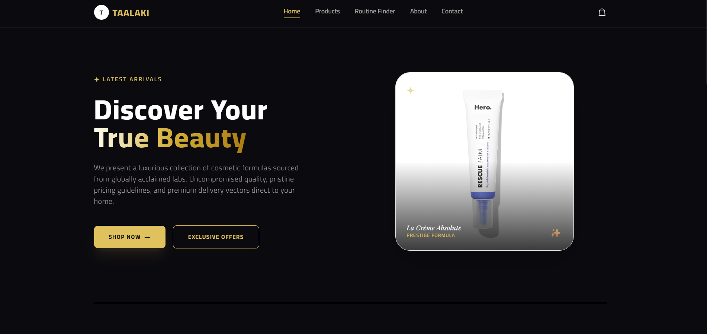

# TAALAKI Prestige Skin Labs — E-Commerce Application

A premium, responsive, dark-themed luxury skincare and cosmetics e-commerce web application built with React and Tailwind CSS. It has five pages: Home, Products, Routine Finder, About and Contact.

## 🚀 Deployment & Links
* **Production Live URL:** https://taalaki-skin-labs.pages.dev/
* **Source Code Repository:** [https://github.com/tarekthedeveloper/taalaki-skin-lab](https://github.com/Tarekthedeveloper/taalaki-labs)
* **Edge Hosting Infrastructure:** Cloudflare Pages Network (Global CDN Optimization)

## ✨ Features
* **Products (dynamic page):** category filter, sorting, expandable ingredient and usage details, and a shopping bag with quantity controls, shipping calculation and a free-shipping progress bar.
* **Routine Finder (dynamic page):** a three-question quiz that builds a morning and night routine from the product catalog.
* **Shared layout:** one `Navbar` and one `Footer` component used on every page.
* **Contact form:** controlled inputs with built-in validation and a confirmation message.
* **Responsive and accessible:** works on mobile, tablet and desktop, with labelled forms, keyboard support and ARIA attributes.

## 🛠️ Tech Stack & Architecture
* **Frontend Core:** React.js (v18+), single-page application with state-based page switching.
* **Styling Framework:** Tailwind CSS with a custom luxury color theme (dark and gold).
* **State Operations:** Hooks (`useState`, `useMemo`, `useEffect`) managing catalog filtering and sorting, and real-time client-side shopping bag totals.

## 📁 Project Structure
```
src/
├── assets/            product and hero images
├── components/
│   ├── Navbar.jsx
│   ├── Footer.jsx
│   ├── Home.jsx
│   ├── Products.jsx
│   ├── Routine.jsx   (Routine Finder)
│   ├── About.jsx
│   └── Contact.jsx
├── App.jsx
└── index.css
```

## 📦 Local Installation Guide
1. Clone the repository: `git clone https://github.com/tarekthedeveloper/taalaki-skin-labs.git`
2. Move into the project folder: `cd taalaki-skin-labs`
3. Install code modules: `npm i`
4. Launch local developer server: `npm start` (use `npm run dev` if the project was created with Vite)

## ⚠️ Known Limitations
* The product catalog is a static array (no database).
* The contact form and newsletter show a confirmation but do not send data yet.
* Checkout is a placeholder (no payment gateway).
* The shopping bag resets when you leave the Products page.

<h2 align="center">📸 Application Preview</h2>

<p align="center">
  
</p>
